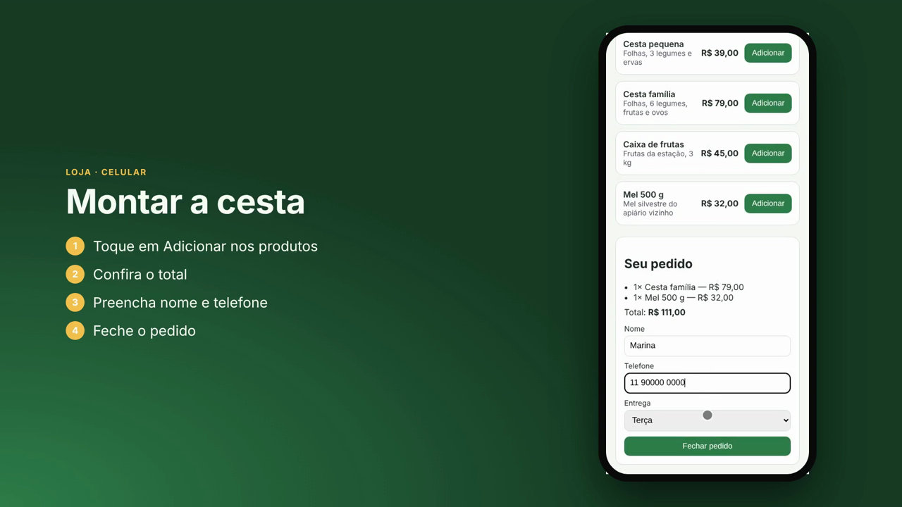

# roteiro-video

Grava o vídeo-manual de um sistema web a partir de um roteiro em JSON. O resultado é um MP4
1920×1080 sem áudio, mais o texto da narração cena a cena com o tempo de cada uma, para gerar a
voz à parte (locução humana ou TTS).

Cada cena é de um de cinco tipos: cartão de abertura, fluxo em etapas, celular (tela gravada numa
moldura, com os passos numerados ao lado), tela de computador com legenda e cartão de fechamento.
O roteiro diz a marca, o endereço do sistema e o que acontece em cada cena; o script navega, grava
e monta o vídeo.

*[English below](#english)*



> Versão de portfólio. A ferramenta nasceu para gravar o manual de um sistema em produção; o
> exemplo aqui usa uma loja fictícia incluída no repositório, e o código em produção é privado
> por contrato.

## Stack

- Node 18+ (ESM), sem framework
- [Playwright](https://playwright.dev) com Chromium: renderiza os cartões, grava a navegação e
  injeta cursor e "ripple" de toque na página
- ffmpeg: composição (fundo + vídeo + moldura/legenda), `tpad` para segurar o último quadro até
  caber a narração, e concatenação final
- Testes com `node:test`, sem dependências extras

## Rodar o exemplo

```bash
npm install
npx playwright install chromium     # uma vez
npm run demo:site                   # loja fictícia em http://127.0.0.1:8010
npm run demo:gravar                 # em outro terminal → saida/video.mp4
```

Precisa de `ffmpeg` e `ffprobe` no PATH. Saída em `saida/`: `video.mp4`, `narracao.md` (texto,
início, fim e duração de cada cena) e `narracao.srt` (legendas).

Para ajustar uma cena sem regravar tudo:

```bash
CENAS=3,4 node gravar.mjs exemplos/loja-demo/roteiro.json saida/
```

## Roteiro

```jsonc
{
  "titulo": "Nome do manual",
  "base_url": "http://127.0.0.1:8010",   // o sistema a gravar (de preferência uma demonstração)
  "sessao": "sessao.json",                // opcional: {"chave": "...", "valor": "..."} no localStorage
  "idioma": "pt-BR",
  "fuso": "America/Sao_Paulo",
  "marca": {
    "nome": "Marca", "subtitulo": "…", "logo": "logo.webp",
    "fundo": "#173b25", "fundo2": "#2f7d4a", "destaque": "#f2c14e", "texto": "#f7fbf5",
    "fonte": "'Figtree', sans-serif", "fonteTitulo": "'Fraunces', serif",
    "fontes": [{ "familia": "Figtree", "arquivo": "figtree.woff2" }]
  },
  "cenas": [
    { "tipo": "capa", "titulo": "…", "subtitulo": "…", "duracao": 5, "narracao": "…" },
    { "tipo": "etapas", "titulo": "…", "etapas": [{ "rotulo": "CLIENTE", "texto": "…" }], "nota": "…", "narracao": "…" },
    {
      "tipo": "celular",                    // ou "tela" (computador, 1600×900)
      "rotulo": "LOJA · CELULAR", "titulo": "…", "itens": ["passo 1", "passo 2"],
      "url": "/", "logado": true, "esperarTexto": "Cestas da semana",
      "acoes": [
        { "clicar": { "papel": "button", "nome": "Adicionar" }, "esperar": 1 },
        { "clicar": "texto visível" },
        { "digitar": [{ "papel": "textbox", "nome": "Nome" }, "Marina"] },
        { "tecla": "Enter" }, { "rolar": 400 }, { "ir": "/outra-pagina" }, { "esperarTexto": "Pronto" }
      ],
      "final": 2,
      "narracao": "…"
    },
    { "tipo": "fechamento", "titulo": "…", "subtitulo": "…", "narracao": "…" }
  ]
}
```

- Caminhos (logo, fontes, sessão) são relativos ao arquivo do roteiro.
- Alvos de ação: `{ "papel", "nome" }` usa `getByRole`; texto solto usa `getByText`; o resto é
  seletor CSS.
- Cada cena dura pelo menos o tempo de narrar o texto dela (2,4 palavras por segundo + 1 s); se a
  gravação for mais curta, o último quadro é segurado.
- O roteiro é validado antes de abrir o navegador: erro de campo aparece com o número da cena e
  da ação, não no meio da gravação.

## Como está organizado

| Arquivo | O que faz |
| --- | --- |
| `gravar.mjs` | CLI: lê o roteiro, grava cena a cena, concatena e escreve a narração |
| `src/roteiro.mjs` | Carrega, valida e resolve caminhos do roteiro |
| `src/cartoes.mjs` | HTML/CSS dos cartões, da moldura do celular e da legenda |
| `src/gravador.mjs` | Playwright (contextos, ações, cursor) e chamadas ao ffmpeg |
| `src/tempo.mjs` | Tempo de narração, carimbos SRT e geração de `narracao.md`/`.srt` |
| `test/` | Testes das partes puras (validação, cartões, tempos) |
| `exemplos/loja-demo/` | Loja fictícia (HTML estático) e o roteiro que a grava |

## Decisões

- **Cartões em HTML, não em ffmpeg `drawtext`.** Tipografia, grid e fontes embutidas ficam
  triviais no navegador; o ffmpeg só recebe PNGs prontos.
- **Vídeo gravado no tamanho da janela.** O Playwright grava a página no tamanho do viewport; a
  escala para a moldura é feita no ffmpeg, que lida melhor com isso do que gravar maior.
- **Narração separada do vídeo.** O MP4 sai sem áudio e com os tempos no `narracao.md`; assim a
  voz pode ser trocada (locutor, TTS, outro idioma) sem regravar nada.
- **Sessão injetada, nunca login automatizado.** Para telas que exigem login, o roteiro injeta
  uma sessão de demonstração no `localStorage`; senha de produção não entra no roteiro.

## Cuidados

- Grave contra uma demonstração com dados fictícios, nunca contra dados reais de clientes.
- O vídeo bruto do Playwright fica em `saida/.trabalho/`; a pasta é descartável.

---

## English

**roteiro-video** records a walkthrough video of a web system from a JSON script. Output is a
1920×1080 MP4 without audio plus the narration text per scene with timestamps, so the voice can
be produced separately (human or TTS).

Scenes come in five types: cover card, step flow, phone (recorded screen in a device frame with
numbered steps beside it), desktop screen with caption, and closing card. The script declares the
brand, the system URL and what happens in each scene; the tool navigates, records and assembles
the video.

> Portfolio version. The tool was built to record the manual of a production system; the example
> here uses a fictional store shipped in the repo, and the production code is private under
> contract.

**Stack:** Node 18+ (ESM, no framework) · Playwright/Chromium for rendering cards, recording
navigation and injecting a visible cursor/tap ripple · ffmpeg for compositing, `tpad` to hold the
last frame until the narration fits, and concatenation · `node:test` for the pure parts.

**Run the example:** `npm install`, `npx playwright install chromium`, `npm run demo:site`, then
`npm run demo:gravar` in another terminal. Requires `ffmpeg`/`ffprobe` on PATH. Use
`CENAS=3,4 node gravar.mjs …` to re-record only some scenes.

**Script format:** see the JSON above. Paths are relative to the script file; action targets use
`getByRole` (`{ "papel", "nome" }`), `getByText` (plain string) or CSS selectors; every scene lasts
at least as long as its narration (2.4 words/s + 1 s); the script is validated before the browser
opens, with scene and action numbers in the error.

**Layout:** `gravar.mjs` (CLI) · `src/roteiro.mjs` (load/validate) · `src/cartoes.mjs` (card
HTML/CSS) · `src/gravador.mjs` (Playwright + ffmpeg) · `src/tempo.mjs` (timing, SRT, narration
files) · `test/` · `exemplos/loja-demo/` (fictional store + script).

**Design notes:** cards are rendered as HTML rather than with ffmpeg `drawtext` (typography and
embedded fonts are trivial in a browser); video is recorded at viewport size and scaled in ffmpeg;
narration is kept out of the video so the voice can change without re-recording; login is never
automated — a demo session is injected into `localStorage` instead.
